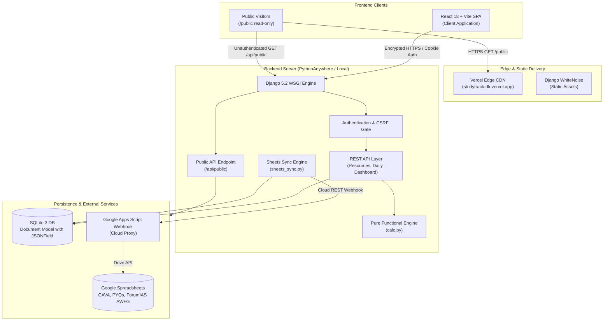
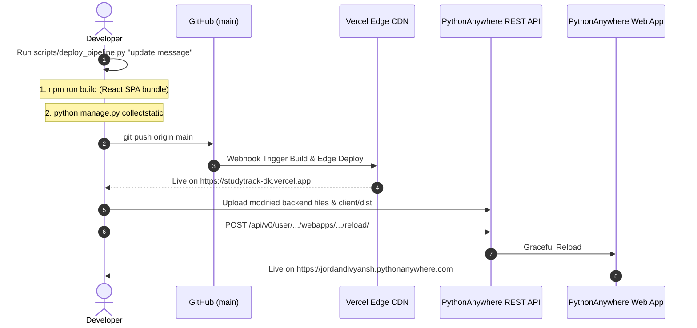

# Master Study Tracker V2 — Complete Zero-to-Hero Guide

> **An Engineering Blueprint, Code Walkthrough, and Deployment Guide for Divyansh's UPSC & APFC Preparation Operating System.**

---

## 1. System Overview & Philosophy

Master Study Tracker V2 is a full-stack, multi-exam preparation operating system. Unlike generic task managers or pomodoro timers, this system is built to address the real-world operational challenges of high-stakes competitive examinations (UPSC Civil Services, UPPSC Prelims, EPFO APFC):

1. **Holistic Preparation Lifecycle**:
   - **Prelims Preparation**: UPPSC Prelims (8 subjects, 142 topics, 20 mocks), EPFO APFC (13 subjects, 230 sub-topics, 236 video lectures).
   - **Mains Test Series & Mocks**: GS 1–4, Essay, Generic copies, ForumIAS AWFG (32 DAWT, 5 ST, 1 FLT), and Lukmaan IAS (10 Full Mocks).
   - **Smartwork Labs PYQ Workbooks (2020–2024)**: 20 sets covering 395 questions across GS 1–4 with 3-stage tracking (Written, Model Review, Notes Enriched).
   - **Video Lecture Cadence**: CAVA (Current Affairs Video Analysis, 36 lectures scheduled and delivered via Google Sheets), World History (Lec 10–16), PubAd Foundation (137 lectures) & Enrichment (33 lectures).
   - **Reading & Backlogs**: 4 PubAd books reading tracker with rate table (pages/hr), September & October newspaper backlog queues.
2. **Cognitive Overload Protection**:
   - Imposes a strict daily capacity ceiling ($8\text{ h/day}$ study + DSA) with a $15\%$ safety buffer.
   - Pacing calculations automatically recalculate remaining required daily study velocity to meet milestones without burnout.
3. **Multi-Platform Deployment & High Availability**:
   - Single-command automated deployment pipeline syncing **GitHub**, **Vercel** (Edge CDN), and **PythonAnywhere** (WSGI web app).
4. **Transparent Accountability**:
   - Public read-only dashboard (`/public`) allows mentors, peers, or friends to view live study consistency, test scores, and lecture progress with zero write permissions.

---

## 2. End-to-End Architecture Diagram



---

## 3. Project Directory Tree Explained

```text
master-study-tracker/
├── backend/                             # Django 5.2 Application Root
│   ├── config/                          # Project configuration & settings
│   │   ├── __init__.py                  # Package identifier
│   │   ├── settings.py                  # Database, WhiteNoise, Security, CSRF, Static config
│   │   ├── urls.py                      # Master URL routing table (REST API + SPA catch-all)
│   │   └── wsgi.py                      # WSGI entry point for PythonAnywhere & Gunicorn
│   ├── master/                          # Primary business application
│   │   ├── calc.py                      # Pure functional formulas (capacities, pacing, derivations)
│   │   ├── models.py                    # Document model (SQLite + JSONField document store)
│   │   ├── schema.py                    # JSON schema validators & natural key extractors
│   │   ├── sheets_sync.py               # Bidirectional Google Sheets sync engine (CLI + Webhook)
│   │   ├── storage.py                   # Data access layer, seeding utilities, document queries
│   │   ├── tests.py                     # Automated unit and integration test suite
│   │   ├── views.py                     # REST API views, Auth, Public endpoint, Dashboard handler
│   │   ├── management/commands/         # Custom Django management commands
│   │   │   └── sync_sheets.py           # CLI command: python manage.py sync_sheets
│   │   └── seed_data/                   # Default bootstrap JSON datasets for cold starts
│   ├── db.sqlite3                       # Local production SQLite database
│   ├── manage.py                        # Django administration command wrapper
│   └── staticfiles/                     # Collected production assets (served via WhiteNoise)
├── client/                              # Modern React SPA (Vite + JSX)
│   ├── index.html                       # HTML5 entry template
│   ├── package.json                     # Frontend dependencies & npm run scripts
│   ├── vite.config.js                   # Vite bundler config with /api proxy to Django
│   └── src/                             # Source code
│       ├── main.jsx                     # React DOM bootstrap & theme initializer
│       ├── App.jsx                      # App shell, navigation router, public routing gate
│       ├── Auth.jsx                     # Authentication forms (Sign In / Register)
│       ├── api.js                       # HTTP client wrapper with CSRF token handling
│       ├── format.js                    # Formatting helpers (dates, hours, currencies, percentages)
│       ├── hooks.js                     # Custom React hooks (useResource, useTimer)
│       ├── styles.css                   # Complete design system & 6 theme token palettes
│       ├── components/                  # Reusable UI widgets
│       │   ├── ThemeSelector.jsx        # Compact & visual grid theme switcher
│       │   ├── TimerBar.jsx             # Persistent sidebar stopwatch with auto-logging
│       │   ├── charts.jsx               # Vector SVG charts (ExamRail, Trajectory, Donut, Rings)
│       │   └── ui.jsx                   # Panels, PageHeaders, Tags, Notices, Loaders
│       └── pages/                       # Application Views
│           ├── Dashboard.jsx            # Authenticated analytics command center
│           ├── PublicView.jsx           # Shareable read-only dashboard for public visitors
│           ├── Daily.jsx                # Daily log editor & retrospective timeline
│           ├── Weekly.jsx               # 23-week capacity and quota management
│           ├── Tests.jsx                # Mock test schedule, scores, and reviews
│           ├── CavaTracker.jsx          # CAVA Current Affairs video lecture pipeline
│           ├── PyqWorkbooks.jsx         # Smartwork Labs GS1-4 question workbooks
│           ├── Backlog.jsx              # Newspaper & syllabus backlog queues
│           ├── Apfc.jsx                 # EPFO APFC 13-subject syllabus coverage
│           ├── GoogleSheetsSync.jsx     # Google Sheets two-way sync management console
│           ├── Settings.jsx             # System configuration, themes, and backup/restore
│           └── Guide.jsx                # Interactive in-app developer guide
├── scripts/
│   └── deploy_pipeline.py               # Automated 1-command deployment across GitHub, Vercel & PA
├── .env                                 # Secrets & API credentials (git-ignored)
└── GUIDE_ZERO_TO_HERO.md                # This manual
```

---

## 4. Deep-Dive into Every Code File

### Backend (Django 5.2)

1. **`backend/config/settings.py`**:
   - Configures Django with WhiteNoise middleware for high-performance static asset caching.
   - Defines `CSRF_TRUSTED_ORIGINS` to allow seamless cross-origin requests from `studytrack-dk.vercel.app` and `jordandivyansh.pythonanywhere.com`.
   - Points database connection to `backend/db.sqlite3`.
2. **`backend/config/urls.py`**:
   - Master routing dispatcher.
   - Dispatches `/api/public/` to `public_dashboard_view` (unauthenticated).
   - Maps `/api/dashboard/`, `/api/daily/`, `/api/sheets/sync/`, and resources.
   - Any non-API route falls back to `v.frontend` to serve the React SPA index.
3. **`backend/master/models.py`**:
   - Defines the single polymorphic model `Document`.
   - Columns: `owner` (FK), `collection` (string), `natural_key` (string), `uid` (24-char hex), `data` (`models.JSONField`), `created_at`, `updated_at`.
   - Contains a database-level `UniqueConstraint(fields=['owner', 'collection', 'natural_key'])` ensuring strict data integrity.
4. **`backend/master/calc.py`**:
   - Pure functional mathematics engine.
   - Computes gross study capacity, DSA deductions, buffer allowances, actual versus planned study variance, and overdue test flags.
   - Because it contains pure functions without side effects, it is completely deterministic and easily testable.
5. **`backend/master/schema.py`**:
   - Schema validation engine ensuring every JSON record conforms to rigorous constraints before persistence.
   - Calculates natural keys (e.g. `YYYY-MM-DD` for daily logs, `Lec XX` for CAVA lectures).
6. **`backend/master/sheets_sync.py`**:
   - Engine supporting bidirectional Google Sheets sync.
   - Automatically detects environment: uses `gsheets` CLI on local macOS machines, and seamlessly switches to the Google Apps Script Webhook API (`https://script.google.com/macros/s/.../exec`) when running on cloud servers (PythonAnywhere/Vercel).
7. **`backend/master/views.py`**:
   - REST API endpoints for login, session check, daily logs, dashboard statistics, and full database backup/restore.
   - Contains `public_dashboard_view` for read-only access.
8. **`backend/master/management/commands/sync_sheets.py`**:
   - Django CLI command wrapper: `python manage.py sync_sheets --direction both`.

---

### Frontend (React 18 + Vite)

1. **`client/src/main.jsx`**:
   - Entry point. Loads `styles.css`, restores the saved theme from `localStorage` before rendering (preventing theme flashing), and mounts `<App />` within `BrowserRouter`.
2. **`client/src/App.jsx`**:
   - Main layout and router.
   - First checks if the URL path starts with `/public`. If true, directly renders `<PublicView />` without requiring any user login!
   - For authenticated users, provides the responsive navigation sidebar, the persistent `TimerBar`, theme selector, and routes to all study trackers.
3. **`client/src/components/ThemeSelector.jsx`**:
   - Multi-theme manager supporting 6 bespoke study environments.
   - Can render both a compact `<ThemeSelector compact />` in the sidebar and a full visual preview card grid in Settings.
4. **`client/src/components/charts.jsx`**:
   - High-performance, zero-dependency SVG charts:
     - `ExamRail`: Visual timeline with exam milestones and countdown needles.
     - `StreamDonut`: Interactive donut chart visualizing study time allocation across GS, Optional, CAVA, CSAT, and DSA.
     - `TrajectoryAreaChart`: 14-day study + DSA trend against daily target cap with a 7-day rolling average trendline.
     - `RadialProgressRing`: Circular radial meters for CAVA lectures, PYQ workbooks, and mock tests.
5. **`client/src/components/TimerBar.jsx`**:
   - Live persistent study stopwatch that runs continuously in the sidebar across page navigations.
   - Saves completed sessions ($\ge 1\text{ min}$) directly into today's daily log with one click.
6. **`client/src/pages/PublicView.jsx`**:
   - Live, unauthenticated, read-only dashboard allowing anyone to view Divyansh's preparation progress.
   - Disables all edit, add, or delete buttons to guarantee complete security.
7. **`client/src/styles.css`**:
   - Modular CSS design system with CSS custom properties (`--paper`, `--surface`, `--line`, `--text`, `--gold`, `--sage`, `--brick`).
   - Defines custom theme color tokens for:
     - **🌓 System Default**: OS media query adaptation.
     - **🌌 Studio Dark**: Classic deep navy and warm gold.
     - **☀️ Clean Light**: Crisp academic paper and rich ink.
     - **🌑 Midnight OLED**: Pure `#000000` pitch black background for OLED screens.
     - **🌲 Forest Emerald**: Deep pine green and calming jade.
     - **☕ Warm Amber**: Warm sepia night focus palette.

---

## 5. Architectural Flow & Deployment Pipeline



### Running the Automated Pipeline

To deploy changes across all environments with one command:
```bash
python3 scripts/deploy_pipeline.py "feat: your feature summary"
```

The script automatically executes:
1. React client production build via Vite (`client/dist/`).
2. Django static asset collection (`backend/staticfiles/`).
3. Git commit & push to GitHub `main` branch (which triggers automatic Vercel Edge build).
4. Direct file synchronization to PythonAnywhere via REST API.
5. PythonAnywhere Web App reload via API token.

---

## 6. Complete REST API Reference

| Method | Endpoint | Auth Required | Description |
| :--- | :--- | :--- | :--- |
| `GET` | `/api/public/` | **No** | Sanitized preparation metrics for public read-only view. |
| `GET` | `/api/session/` | **No** | Returns current authentication state and CSRF token. |
| `POST` | `/api/login/` | **No** | Authenticates user session with username and password. |
| `POST` | `/api/logout/` | **Yes** | Terminates authenticated session. |
| `GET` | `/api/dashboard/` | **Yes** | Aggregated preparation metrics, today log, streak, and 14-day history. |
| `GET` | `/api/daily/` | **Yes** | Retrieve daily logs within a specified date range. |
| `PUT` | `/api/daily/<YYYY-MM-DD>/` | **Yes** | Update study hours, DSA, gym, or weight for a specific day. |
| `DELETE` | `/api/daily/<YYYY-MM-DD>/` | **Yes** | Remove logged entries for a specific day. |
| `GET` | `/api/settings/` | **Yes** | Retrieve global configuration (daily cap, exam dates, buffer). |
| `PUT` | `/api/settings/` | **Yes** | Update global configuration. |
| `GET` | `/api/<collection>/` | **Yes** | Query collection items (`cava`, `pyqs`, `tests`, `weeks`, `backlog`, `apfc/*`). |
| `POST` | `/api/<collection>/` | **Yes** | Create a new document in the specified collection. |
| `PATCH` | `/api/<collection>/<uid>/` | **Yes** | Update document by unique 24-char UID. |
| `DELETE` | `/api/<collection>/<uid>/` | **Yes** | Delete document by unique 24-char UID. |
| `POST` | `/api/sheets/sync/` | **Yes** | Trigger bidirectional Google Sheets synchronization. |
| `GET` | `/api/backup/` | **Yes** | Export complete JSON backup of all 10 collections. |
| `POST` | `/api/restore/` | **Yes** | Idempotently restore database from JSON backup. |

---

## 7. Public Read-Only View Specification

- **Public URL**: `https://studytrack-dk.vercel.app/public` (and `https://jordandivyansh.pythonanywhere.com/public`)
- **Security Guarantees**:
  - No database write operations are exposed on `/api/public/`.
  - Credentials, Google Apps Script tokens, and user account metadata are stripped.
  - The frontend renders no input fields, buttons with mutations, or delete confirmations.
  - All visitors can toggle their preferred visual theme freely, with choices remembered in their local browser.
